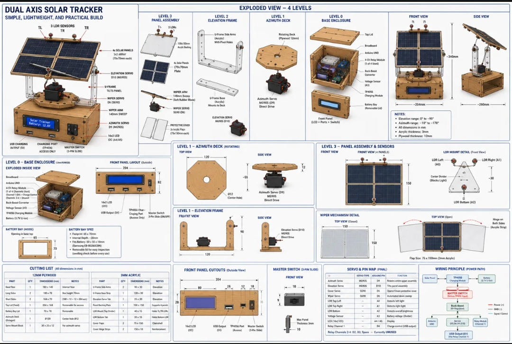

# Dual-Axis Solar Tracker

An Arduino Uno solar panel mount that follows the sun on two axes, protects the panel
with an automatic cover at night, wipes it clean at dawn, and charges devices over USB
from the harvested energy. An A2 Computer Science / Physics / Mathematics project by
Anas Mohammed.

**Status: in progress.** Electronics and code are working on the bench; the physical
frame (MDF enclosure, acrylic panel assembly) is being fabricated and the full system
has not yet completed an outdoor end-to-end run. This repo is updated as the build
progresses — see the commit history.

## Why

Botswana receives over 3,200 hours of sunshine a year (Government of Botswana), which
makes sun tracking worth investigating. This project is a low-cost LDR-based dual-axis
tracker built from school-workshop materials and hobby electronics.

It has not yet measured an energy gain. There is no current sensing, so no power or
net-energy figure exists, and no fixed-vs-tracked comparison has been run. A future
revision will add current measurement to quantify any gain after tracking overhead
(servo and control power).

## How it works

- **Tracking** — three LDRs (top-left, top-right, bottom) separated by a divider and
  mounted on top of the panel assembly, outside the cover, so closing the cover never
  shades them.
  Left/right difference drives the azimuth servo; top-average vs bottom drives
  elevation. A tolerance deadband prevents jitter.
- **Cover** — an SG90-driven clamshell cover closes when ambient light drops below a
  threshold (night) and reopens at dawn.
- **Dawn wiper** — a wiper arm with a soft rubber blade sweeps the panel once on each
  night-to-day transition.
- **Charging station** — four 70×70 mm panels (parallel, one diode each) feed a TP4056
  + boost-converter chain to a USB output, switched by a relay with hysteresis on battery
  voltage. An I2C LCD shows battery level, USB state, and cover/day-night state.
- **Split power** — logic runs from the Li-ion cell; the four servos run from two
  separate 4-cell AA battery packs. Running everything off one rail caused voltage sag and Arduino resets
  under servo load, so the supplies were separated (details in
  [docs/components.md](docs/components.md)).

## Design



*Original design concept: four levels (base enclosure, azimuth deck, elevation frame,
panel assembly). The build follows this layout with one change: the wooden parts are
20 mm MDF instead of 12 mm plywood. Servo pins in the image predate the final wiring;
the current pin map is in [docs/components.md](docs/components.md).*

## Hardware

Arduino Uno R3 · 2× MG90S (azimuth, elevation) · 2× SG90 (cover, wiper) · 3× LDR ·
16×2 I2C LCD · resistor-divider voltage sensor · TP4056 · MT3608 boost converter ·
4-channel relay · Samsung EB-BG360CBN Li-ion cell · 4× 70×70 mm solar panels ·
20 mm MDF base + 3 mm acrylic panel assembly.

Full list and pin map: [docs/components.md](docs/components.md).

## Repository layout

```
solar_tracker_main/  Arduino sketch (all four .ino files must stay together in this folder)
docs/             Components, pin map, power design, status & roadmap
docs/blueprint/   Design concept image + build blueprint (PDF) with dimensions and cutting lists
docs/build-supplement.pdf   Build log and photo record
```

## Running it

1. Open `solar_tracker_main/solar_tracker_main.ino` in the Arduino IDE (the folder name must match the main file name; keep all `.ino` files in it).
2. Install the `LiquidCrystal_I2C` library (`Servo` and `Wire` ship with the IDE).
3. Upload to an Uno; open the Serial Monitor at 9600 baud for live tracking, cover,
   wiper and charging logs.

## Build record

[docs/build-supplement.pdf](docs/build-supplement.pdf) — the as-built record: changes
from the original proposal, build log by phase, and 84 captioned photos.

## Status and roadmap

See [docs/status.md](docs/status.md) for what is working, what is still being tested,
and what is next.
